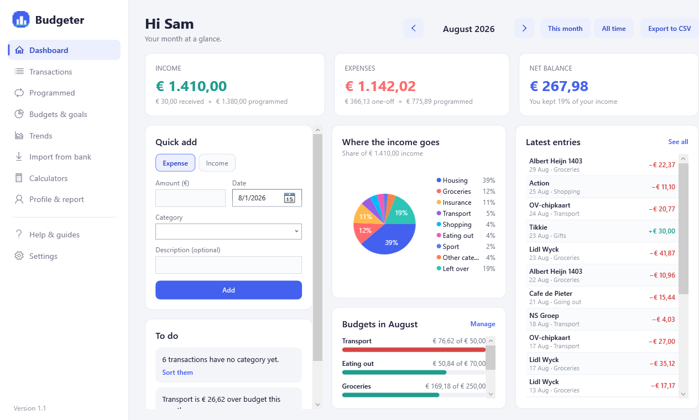
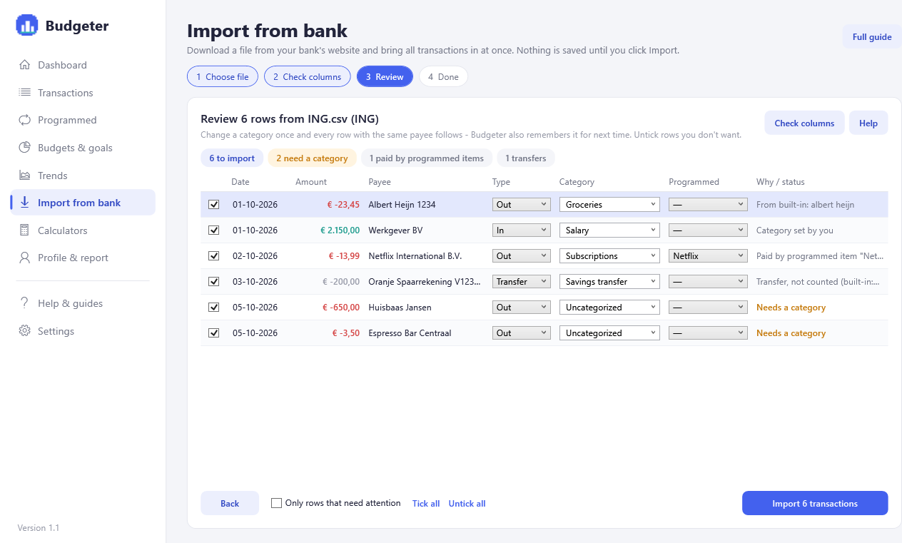
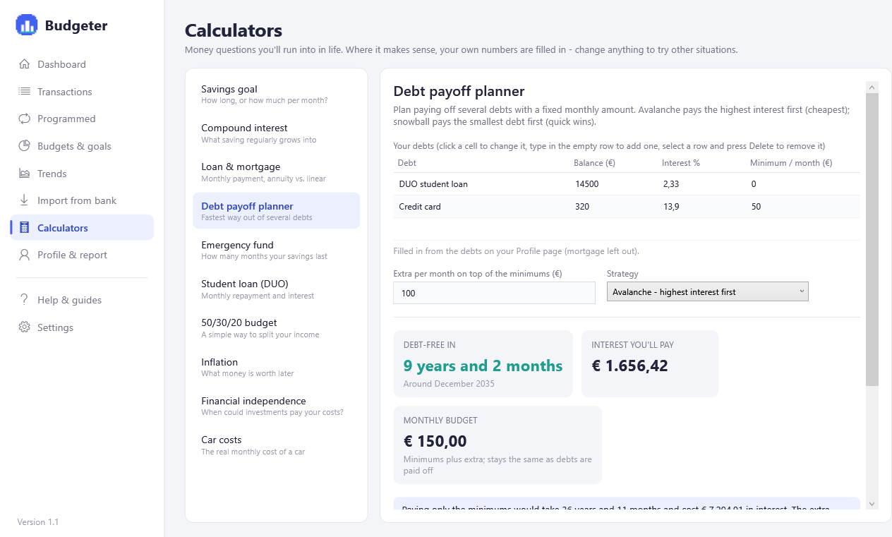
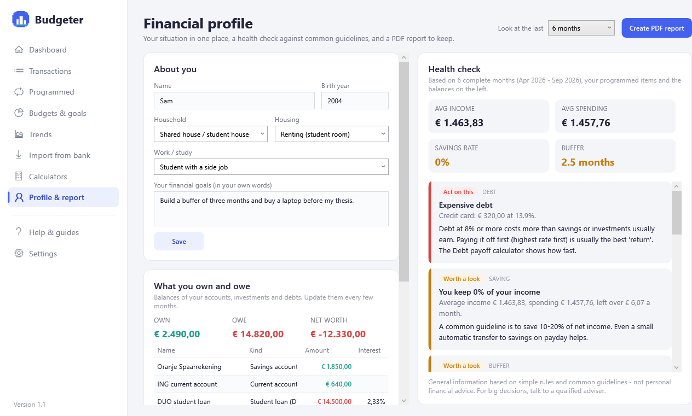
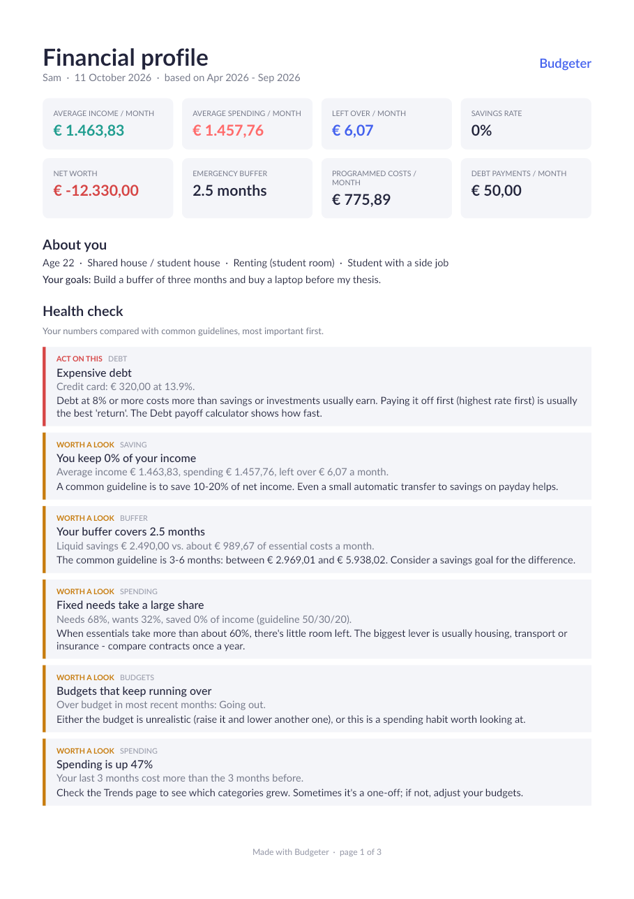

# Budgeter

A personal budget app for Windows (WPF, .NET 8). Track income and spending, import your bank's transactions, set budgets and goals, use financial calculators, and get a health check of your finances as a PDF report. Everything stays on your own computer.



## Features

- **Dashboard** per month (or all time): income, spending, what's left, where the money goes, budgets, latest entries and a to-do list
- **Import from your bank** — ING, Rabobank and ABN AMRO files are recognised automatically; any other bank's CSV works with a column check. Step-by-step download guides for each bank are built in
  - Categories are filled in by your own rules plus a built-in list of Dutch shops (Albert Heijn, NS, Ziggo…). Change a category once and Budgeter remembers it
  - Transfers to your own savings are recognised, payments of programmed items (rent, Netflix, salary) are linked so they aren't counted twice, and re-importing the same period never creates doubles
  - Every import can be undone
- **Transactions** — search, filter, edit, delete and re-categorise many rows at once
- **Programmed income & costs** — salary, rent, subscriptions, insurance: entered once, counted every month; pause what you cancel
- **Budgets & savings goals** — limits per category (or let Budgeter suggest them from your spending), goals with a monthly plan
- **Trends** — 6/12/24 months of income vs. spending, savings rate, one category over time
- **10 calculators** — savings goal, compound interest, loan & mortgage (annuity vs. linear), debt payoff (avalanche vs. snowball), emergency fund, student loan (DUO), 50/30/20 budget, inflation, financial independence, car costs. Pre-filled with your own numbers where it makes sense
- **Financial profile & PDF report** — what you own and owe, a rule-based health check (savings rate, buffer, expensive debt, 50/30/20, budgets, subscriptions, goals) and a PDF report to keep
- **Help & guides** — step-by-step guides for everything, including each bank's download steps
- **Safe data** — stored in `%APPDATA%\BudgetApp\budget.db` (SQLite), automatic daily backups, one-click restore, and older databases are upgraded in place
- **Updates itself** from GitHub releases

| Import review | Calculators | Profile & health check | PDF report |
|---|---|---|---|
|  |  |  |  |

## Install / update

1. Download `BudgetApp.exe` from the [Releases](../../releases) page. (Windows SmartScreen may warn because the app isn't code-signed: *More info* → *Run anyway*.)
2. Put it in one permanent folder, e.g. `C:\Git Projects\Budgeter\publish\` (Git ignores that folder), and make your shortcut / taskbar pin point there.
3. From then on, Budgeter shows **Install update** in the sidebar when a new version is out and replaces itself in the same place, so the shortcut keeps working.

Prefer building it yourself? Run `update_and_build.bat`: it does `git pull` and rebuilds `publish\BudgetApp.exe` in place.

> Don't use a shortcut to `BudgetApp\bin\Debug\...`: that's a frozen test build. Budgeter shows a warning when started from such a folder. The in-app guide *Help → Updating Budgeter and fixing your shortcut* walks through moving it.

## Run from source

Requires the [.NET 8 SDK](https://dotnet.microsoft.com/download). Open `Budgeter.sln` in Visual Studio, or:

```bash
dotnet run --project BudgetApp
```

## Project structure

| Folder | What's in it |
|---|---|
| `BudgetApp.Core` | All logic that doesn't need Windows: models, money parsing, budget maths, bank import (CSV reader, bank detection, rules, duplicate matching), calculators, financial profile & health check. No NuGet packages. |
| `BudgetApp` | The WPF app: pages, database (EF Core + SQLite, `SchemaMigrator` for upgrades), backups, updater, PDF report (QuestPDF), self-test. |
| `BudgetApp.Tests` | Dependency-free tests for `BudgetApp.Core` (`dotnet run --project BudgetApp.Tests`). |

### Database upgrades

The data format version is SQLite's `user_version`. `SchemaMigrator` upgrades older files step by step inside a transaction, after copying the file to `Backups\`. To change the database: add a new step in `SchemaMigrator.Steps`, bump `LatestVersion`, and add the property to the model.

### Checks on every push

GitHub Actions (`.github/workflows/ci.yml`) runs on Windows:

1. the logic tests;
2. builds the single-file `BudgetApp.exe` exactly like a release;
3. runs `BudgetApp.exe --self-test <folder>`, which upgrades a Budgeter 1.0 database, imports example ING/Rabobank/ABN AMRO files, re-imports and undoes an import, creates the PDF, and opens every page and calculator. It fails on errors or broken data bindings.

The self-test's screenshots, log and PDF are pushed to the `ci-screenshots` branch.

## Releasing a new version

Bump the number in `VERSION` (and the changelog below) and push to `main`. GitHub Actions runs the tests and the self-test, builds `BudgetApp.exe` and publishes the release; installed copies then offer the update.

## Changelog

- **2.0** — Big update: import bank files (ING, Rabobank, ABN AMRO, any CSV) with automatic categories, transfer and duplicate detection and undo; new sidebar layout with Transactions, Programmed, Budgets & goals, Trends, Calculators, Profile & report, Help and Settings pages; programmed income; budgets and savings goals; 10 financial calculators; financial profile with health check and PDF report; step-by-step guides; automatic backups and restore; in-app updates; safe upgrade of existing data
- **1.1** — Fixes: amounts like 12.50 were saved as 1250 on Dutch Windows; tables showed $ instead of €; totals mixed all-time income with one month of programmed expenses. New: month-by-month view, edit entries, pause programmed expenses, start dates, delete confirmations, Enter to submit, CSV that opens correctly in Dutch Excel
- **1.0** — First release: dashboard, income/expense entries, recurring expenses, pie chart, CSV export
